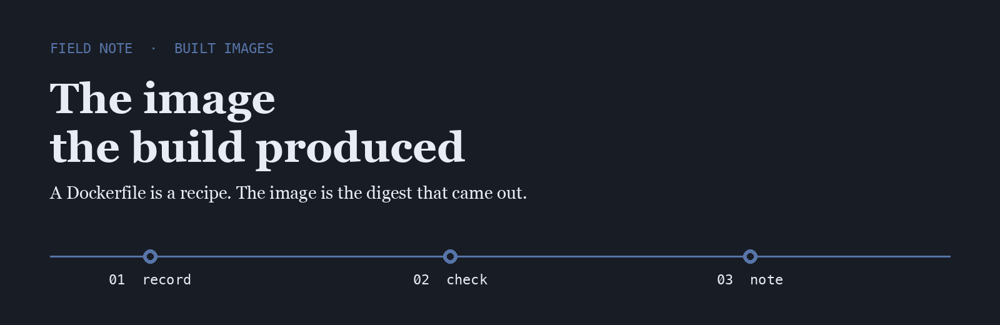
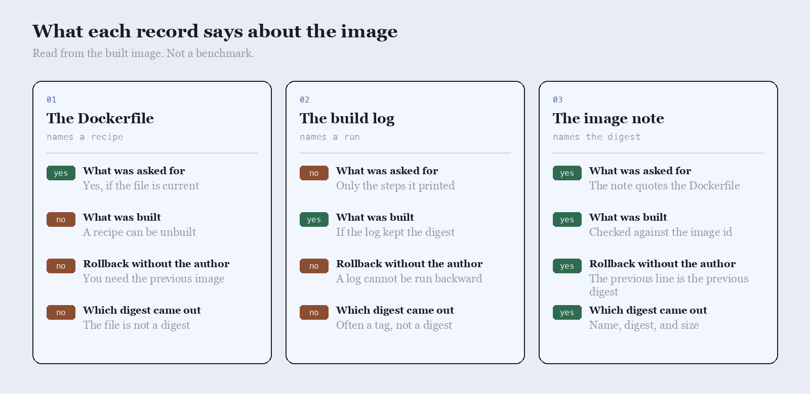

<p align="center">
  
</p>

# Forge Hex

Forge Hex is the name I use when two builds share a Dockerfile and publish two different digests.

## The question

People trust the Dockerfile, the build log, or a note taken from the image that was produced. I asked which of those tells you what was built.

<p align="center">
  
</p>

|  | The Dockerfile | The build log | The image note |
| --- | --- | --- | --- |
| What was asked for | Yes, if the file is current | Only the steps it printed | The note quotes the Dockerfile |
| What was built | A recipe can be unbuilt | If the log kept the digest | Checked against the image id |
| Rollback without the author | You need the previous image | A log cannot be run backward | The previous line is the previous digest |
| Which digest came out | The file is not a digest | Often a tag, not a digest | Name, digest, and size |

## The line I keep

One line, written after the image exists and the digest is read back. The rollback is the previous line.

```text
2026-10-01T02:14:55Z  image  ghcr.io/forge/edge  sha256:4e91c0a  size  81244112
```

Build tools already know how to run a Dockerfile. The gap is a line that says which image was produced, written by someone who read the digest.

- [buildkit](https://github.com/moby/buildkit) is the builder I read when a recipe and a digest disagree
- [kaniko](https://github.com/GoogleContainerTools/kaniko) builds the image without a daemon in the room
- [earthly](https://github.com/earthly/earthly) names the build as a file I can read before it runs

I keep a fork of each on this account.

## What I pay attention to

- A digest copied from the image, not from the build log
- A size that matches the image that was pushed
- A rollback that is the previous digest, not a rebuild
- Tools small enough to read in one sitting

## Working with me

Send a short problem statement, a way to see it happen, and what done looks like. I am independent, remote, and usually around during the Adelaide workday.
